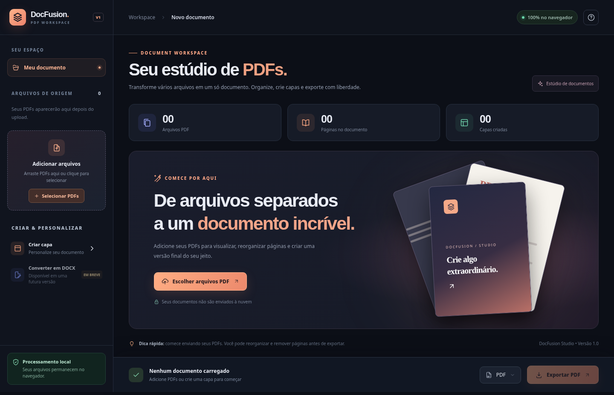

<div align="center">

# 📄 DocFusion

**Organize. Combine. Personalize.**

Uma aplicação web para reunir arquivos PDF, reorganizar páginas, criar capas e exportar um único documento — diretamente no navegador.


**[🌐 Acessar versão online](https://mateuscanjerana.github.io/DocFusion/)** · **[🗺️ Roadmap](./roadmap.md)** · **[🐛 Issues](https://github.com/mateuscanjerana/DocFusion/issues)**

> **Status:** a V1.0 é um protótipo funcional em evolução. A validação completa do fluxo de mesclagem e exportação, em diferentes tipos de PDF e navegadores, ainda é uma etapa de trabalho.

</div>

---

## ✨ Sobre o projeto

O **DocFusion** nasceu para simplificar uma tarefa comum: transformar vários PDFs separados em um documento organizado. Na V1, o foco é oferecer um fluxo intuitivo para **importar, visualizar, ordenar, personalizar e exportar** páginas.

No longo prazo, o projeto pretende evoluir para um **estúdio de documentos**, com editor de texto, arquivos DOCX e o **SmartLayout**, um diagramador automático baseado inicialmente em modelos e regras, com possibilidades futuras de IA e machine learning.

## 🖥️ Prévia da aplicação



> A imagem acima corresponde à interface da V1.0. O arquivo `docs/preview.png` precisa acompanhar este README no repositório.

## ✅ Recursos da V1.0

- **Importação de múltiplos PDFs:** selecione arquivos ou arraste-os para a aplicação.
- **Visualização de páginas:** confira miniaturas, navegue pelas páginas e ajuste o zoom da prévia.
- **Organização visual:** reordene páginas por arrastar e soltar, inclusive entre arquivos diferentes.
- **Edição estrutural:** gire, duplique ou exclua páginas e remova arquivos de origem.
- **Criador de capas:** escolha entre três estilos (gradiente, minimalista e editorial) e personalize título, subtítulo, autor e data.
- **Posicionamento de capas:** insira uma capa no início, após a página selecionada ou no final.
- **Exportação para PDF:** gere um único documento com a sequência escolhida.
- **Processamento local:** a V1 não requer cadastro, banco de dados ou backend para manipular PDFs.

## 🚀 Experimente online

**Endereço previsto para o GitHub Pages:**

### 👉 https://mateuscanjerana.github.io/DocFusion/

> Se a página ainda não estiver disponível, verifique se o repositório é público e se o GitHub Pages foi ativado para a branch e a pasta corretas. As instruções estão na seção [Publicação no GitHub Pages](#-publicação-no-github-pages).

## 🛠️ Tecnologias utilizadas

| Tecnologia | Utilização |
| --- | --- |
| **HTML5** | Estrutura e elementos de interface |
| **CSS3** | Estilização, responsividade e identidade visual |
| **JavaScript (Vanilla JS)** | Interações, estado e processamento da aplicação |
| **[PDF.js](https://mozilla.github.io/pdf.js/)** (3.11.174) | Leitura e pré-visualização de páginas PDF |
| **[pdf-lib](https://pdf-lib.js.org/)** (1.17.1) | Manipulação, composição e exportação de PDFs |
| **[SortableJS](https://sortablejs.github.io/Sortable/)** (1.15.6) | Arrastar e reordenar páginas |
| **Canvas API** | Desenho das capas personalizadas |
| **SVG** | Ícones da interface |

As bibliotecas externas e fontes são carregadas por CDN; portanto, é necessária conexão com a internet para obtê-las quando não estiverem armazenadas no cache do navegador.

## 📦 Executando localmente

**Opção 1 — Abrir diretamente:** clone ou baixe o projeto, extraia os arquivos (se necessário) e abra `index.html` no navegador.

**Opção 2 — Executar com um servidor local (recomendado para desenvolvimento):** na pasta do projeto, execute:

```bash
python -m http.server 8000
```

Acesse **http://localhost:8000** no navegador. Também é possível utilizar a extensão **Live Server** no Visual Studio Code.

Não é necessário instalar dependências via npm para executar a V1 original.

### Como usar

1. Clique em **Selecionar PDFs** ou arraste os arquivos para a janela.
2. Selecione as miniaturas para visualizar as páginas.
3. Reorganize as páginas arrastando pela alça, ou use os comandos de rotação, duplicação e exclusão.
4. Clique em **Criar capa**, escolha o modelo, preencha os campos e determine a posição.
5. Revise a sequência e clique em **Exportar PDF**.

## 🗂️ Estrutura de arquivos

```text
DocFusion/
├── index.html          # Interface principal
├── styles.css          # Estilos e responsividade
├── app.js              # Lógica do organizador e exportação
├── icons.js            # Ícones SVG
├── README.md           # Documentação do projeto
├── roadmap.md          # Planejamento das versões futuras
├── docs/
│   └── preview.png     # Captura de tela da V1
└── exemplos/
    ├── exemplo-1.pdf
    └── exemplo-2.pdf
```

## 🧭 Roadmap

| Versão | Direção de evolução | Situação |
| --- | --- | --- |
| **V1.0** | Mesclador, organizador, pré-visualização e capas | Protótipo; validação pendente |
| **V1.1** | Testes, estabilidade, salvar projetos e desfazer/refazer | Planejado |
| **V2.x** | Editor de texto, títulos, parágrafos, estilos e layouts | Planejado |
| **V3.0–V3.1** | Exportação DOCX/PDF e integração entre editor e organizador | Planejado |
| **V3.2–V3.3** | **SmartLayout:** diagramação por regras e modelos | Planejado |
| **V4.x** | Conversão avançada, reconhecimento estrutural e IA assistiva | Pesquisa e planejamento |
| **V5.x** | Otimização de diagramação e possível uso de machine learning | Visão futura |

O detalhamento técnico, as dependências e os critérios de aceitação estão em **[roadmap.md](./roadmap.md)**.

## ⚠️ Limitações atuais

- **Não converte PDFs para DOCX** e não edita diretamente o texto existente em PDFs importados.
- **Não possui OCR** para documentos digitalizados.
- O estado de edição **não é salvo** após atualizar ou fechar a aba.
- A V1 impõe limites preventivos de **30 MB por arquivo, 120 MB no total e 240 páginas**; documentos menores também podem exigir muita memória, dependendo do dispositivo.
- PDFs protegidos por senha, corrompidos ou com estruturas especiais podem não ser compatíveis.
- Elementos como assinaturas digitais, campos interativos e anotações complexas podem não ser preservados no PDF exportado.
- As capas da V1 são inseridas como **imagem**, de modo que seu texto não é selecionável no arquivo exportado.
- A aplicação está em fase de testes; revise o PDF gerado antes de utilizá-lo em situações importantes.

## 🔒 Privacidade

Na V1, os arquivos PDF são processados **localmente no navegador**, sem upload de documentos para um servidor da aplicação. Há requisições para carregar bibliotecas e fontes externas via CDN, mas os arquivos selecionados não são enviados a esses serviços pelo fluxo atual.

O projeto ainda não passou por auditoria de segurança. Não trate a versão de protótipo como solução certificada para documentos altamente sensíveis.

## 🌐 Publicação no GitHub Pages

1. Crie o repositório público **`DocFusion`** na conta **[`mateuscanjerana`](https://github.com/mateuscanjerana)**.
2. Envie **`index.html`, `styles.css`, `app.js` e `icons.js` para a raiz** do repositório, junto com `README.md`, `roadmap.md`, `docs/preview.png` e a pasta `exemplos` (opcional para o site).
3. Vá em **Settings → Pages → Build and deployment**.
4. Em **Source**, selecione **Deploy from a branch**; escolha a branch de publicação (por exemplo, `main`) e a pasta **`/(root)`**.
5. Salve e acompanhe a publicação. Quando estiver concluída, a aplicação deverá ficar disponível em **https://mateuscanjerana.github.io/DocFusion/**.

> O nome do repositório e a capitalização no endereço precisam corresponder. Este README não publica o site automaticamente.

## 🤝 Contribuições e feedback

Sugestões, relatos de bugs e ideias para novas funcionalidades podem ser registradas na aba [Issues](https://github.com/mateuscanjerana/DocFusion/issues) do repositório, após sua publicação.

## 👨‍💻 Desenvolvimento

Desenvolvido por **[Mateus Canjerana](https://github.com/mateuscanjerana)** como projeto de estudo e prática em desenvolvimento web e engenharia de software.

**DocFusion — de arquivos separados a documentos organizados.**

> **Licença:** ainda não definida. Antes de disponibilizar o código para reutilização sob termos específicos, adicione um arquivo `LICENSE` à raiz do repositório.
